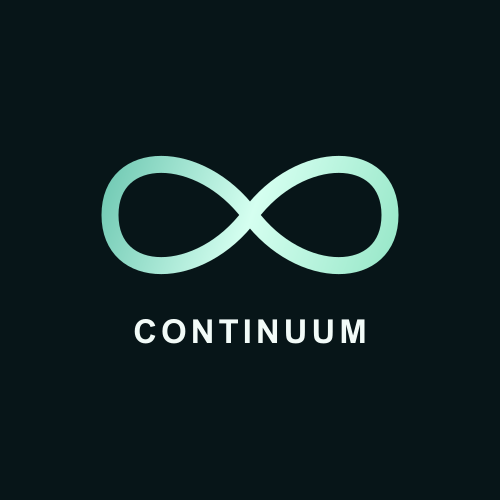
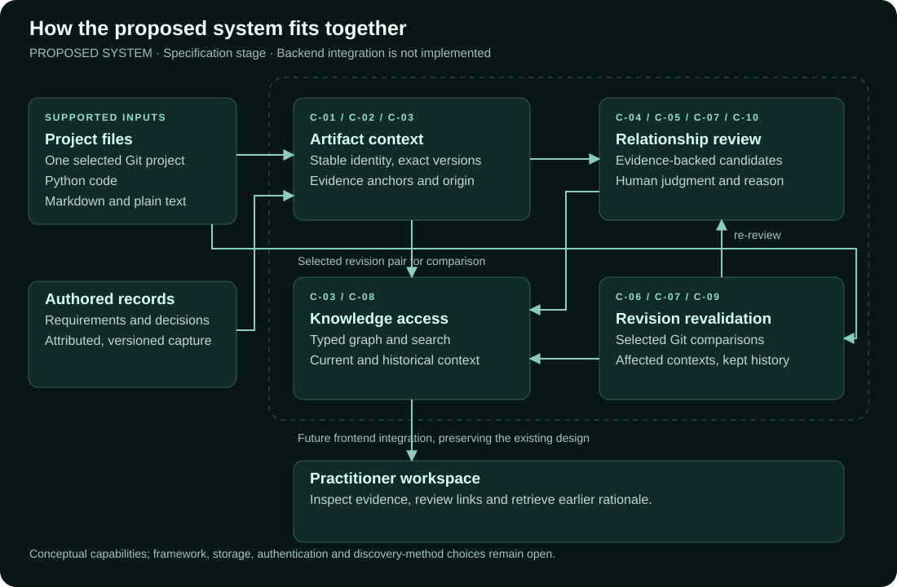
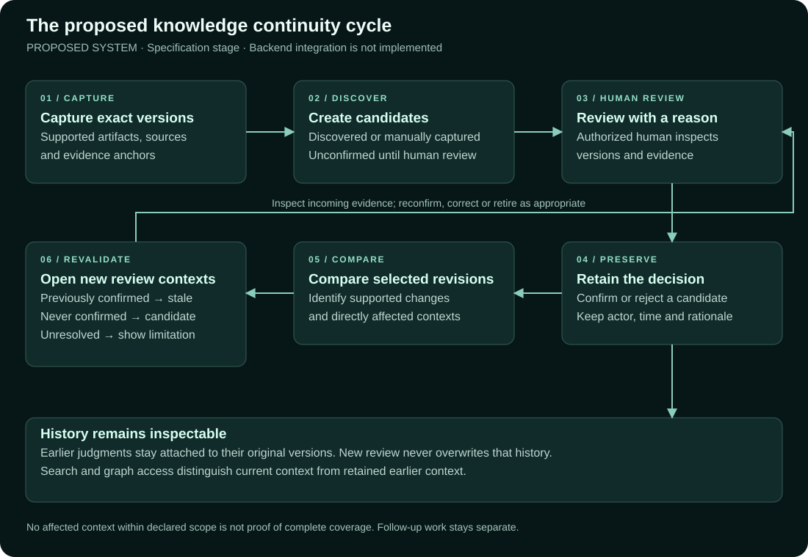

<div align="center">



# Continuum

**Keeping software knowledge connected as projects evolve.**

An integrated software knowledge continuity research prototype.


[Overview](#overview) &nbsp; · &nbsp; [Proposed system](#proposed-system) &nbsp; · &nbsp; [Research](#research) &nbsp; · &nbsp; [Project guide](#project-guide) &nbsp; · &nbsp; [Local commands](#local-commands) &nbsp; · &nbsp; [Agent skills](#agent-skills)

</div>

> [!IMPORTANT]
> **Work in progress.** Continuum is under active specification and development as part of an ongoing thesis. Features, requirements and technical decisions may change. The current frontend demonstrates workflows with synthetic data; the proposed backend and real repository processing are not yet verified.

## Overview

Continuum is a software knowledge continuity research prototype guided by the Software Knowledge Continuity Framework (SKCF). The proposed system connects project artifacts, relationship evidence, human review decisions and their revision history.

| Focus | Intended outcome |
| --- | --- |
| Artifact context | Identify project artifacts and the exact versions behind them. |
| Relationship evidence | Make candidate links inspectable before a human accepts or rejects them. |
| Accountable review | Retain decisions, reasons and earlier review context. |
| Change and continuity | Revisit affected relationships and retrieve current or historical knowledge. |

These outcomes describe the proposed system. See the current status below for implementation boundaries.

## Proposed system

The diagrams below summarize the [active continuity proposal](openspec/changes/establish-versioned-continuity-core/proposal.md). They describe intended behavior, not a connected or verified backend. Framework, storage, authentication and discovery-method choices remain open.

### How the parts fit together

Supported project files and captured requirements/decisions provide versioned context. Proposed services connect that context to evidence-backed candidates, accountable review and current/historical knowledge access. The existing frontend is the visual reference for a later, separately scoped integration.



[Editable Mermaid source](docs/diagrams/proposed-system.mmd) · [Artifact context](openspec/changes/establish-versioned-continuity-core/specs/artifact-context/spec.md) · [Knowledge access](openspec/changes/establish-versioned-continuity-core/specs/knowledge-access/spec.md)

### How knowledge stays connected after a change

A relationship starts as a candidate. An authorized reviewer inspects exact versions and evidence before recording a decision and reason. Selected revision comparisons can open new review contexts; earlier confirmations stay attached to their original versions. Content concerns and follow-up completion remain separate from relationship validity.



[Editable Mermaid source](docs/diagrams/continuity-cycle.mmd) · [Relationship review](openspec/changes/establish-versioned-continuity-core/specs/relationship-review/spec.md) · [Revision revalidation](openspec/changes/establish-versioned-continuity-core/specs/revision-revalidation/spec.md)

## Research

This repository is part of an ongoing thesis by **Linaban, Jimenez, and Marasigan** from the **Polytechnic University of the Philippines, Quezon City Campus (PUP Quezon City)**.

> **Continuum: Development and Evaluation of an Integrated Software Knowledge Continuity System**

The project supports the thesis's development and evaluation work. It remains a research prototype; this repository does not represent a completed thesis or final evaluation results.

## Current status

The project is in specification development. The existing application is a React 19 / Vite 8 frontend using synthetic fixtures and browser storage. A connected backend and real repository processing have not been verified.

The proposed continuity cycle covers artifact capture, evidence-backed relationship candidates, authorized review with rationale, selected Git revision comparisons, revalidation and access to current and historical context. These are proposed capabilities, not completed implementation.

Healthchecks is the accepted future demonstration input, with Python as its selected code language and Markdown/plain-text documents at file scope. Source acquisition, exact revisions, inventory and expected outcomes remain prerequisites. This does not select Continuum's backend language or database.

## Project guide

| Document | Start here for |
| --- | --- |
| [Project instructions](AGENTS.md) | Scope, permissions and evidence rules |
| [Product context](PRODUCT.md) · [Design reference](DESIGN.md) | Product direction and the existing visual system |
| [OpenSpec guide](openspec/README.md) | Planning workflow and capability layout |
| [Observed frontend behavior](openspec/specs/frontend-demo/spec.md) | The current synthetic baseline |
| [Active continuity proposal](openspec/changes/establish-versioned-continuity-core/proposal.md) | Proposed requirements and design |
| [Research and traceability index](specs/README.md) | Background contracts, requirements and verification plans |
| [Recorded manuscript source](specs/manuscript-source.md) | PDF identity and checked anchors |

The user also supplied the [Google Docs manuscript](https://docs.google.com/document/d/1pryZil7KuXRVWHY_rqvegNWvpVQ7THc3yylj5g7srNs/edit?tab=t.gi0irrwhheuz). Its relationship to the recorded PDF snapshot still needs revision reconciliation; the two sources must not be assumed identical.

## Local commands

The following commands are available for separately authorized development and verification. This README does not start services or authorize implementation.

```powershell
npm ci
npm run dev
npm run build
npm run lint
node --test src/data/workflow.test.js
```

OpenSpec is pinned to 1.16.1 and runs without adding an application dependency:

```powershell
npm exec --offline --yes --package=@fission-ai/openspec@1.16.1 -- openspec list --json
npm exec --offline --yes --package=@fission-ai/openspec@1.16.1 -- openspec list --specs --json
npm exec --offline --yes --package=@fission-ai/openspec@1.16.1 -- openspec validate --all --strict
```

If the pinned CLI is not cached, omit `--offline`. Structural specification validation does not prove functional behavior. Keep unimplemented requirements under `openspec/changes/`; `openspec/specs/` describes observed behavior.

## Agent skills

Project-local skills live under `.agents/skills/` and load when relevant to a task:

- OpenSpec: exploration, proposals, artifact updates and later implementation workflows.
- Ponytail: bounded changes and reuse of existing code.
- Impeccable: targeted interface review and refinement within the existing design.
- Vercel React Best Practices and Composition Patterns: React performance and component structure.
- API Design Principles and Auth Implementation Patterns: API contracts, identity and authorization.
- Python Testing Patterns and Property-Based Testing: example tests and domain invariants.
- FastAPI Templates: guidance if FastAPI is selected.
- Neo4j modeling, Cypher and Python driver skills: guidance if Neo4j is selected.

Source commits and entrypoint hashes are recorded in the [development skill manifest](.agents/skills/development-install-manifest.json) and [backend skill manifest](.agents/skills/backend-install-manifest.json). Skill installation does not select a backend stack, enable hooks or implement a capability. Project instructions and explicit user scope take precedence over skill defaults.

## Verification boundaries

Report source checks, automated tests, browser behavior, backend integration and demonstration results separately. Preserve exact artifact/evidence versions and earlier review decisions. No functional pass follows from installing skills, creating Git metadata or writing this README.
